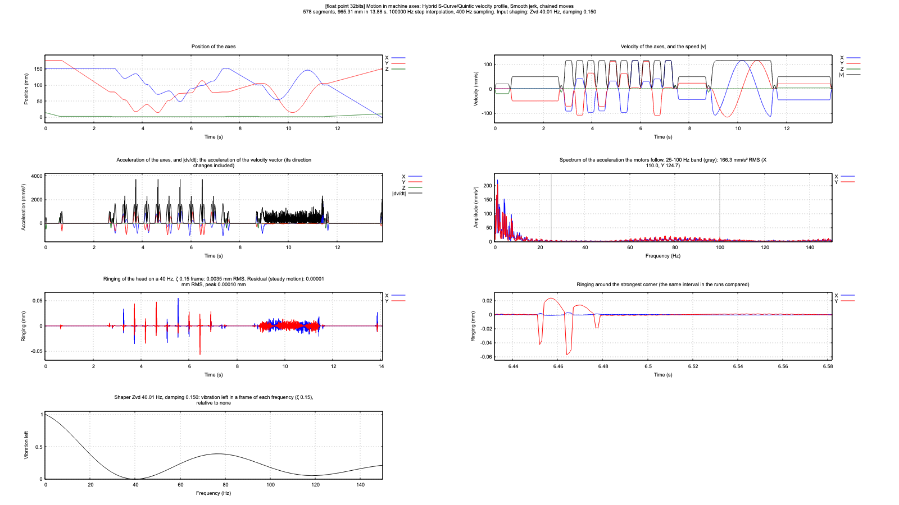
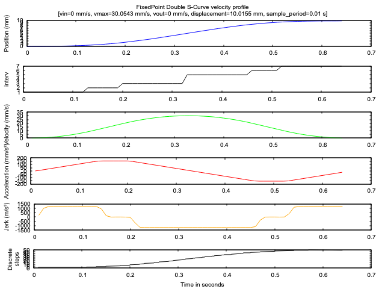

[](https://crates.io/crates/prinThor)

[](https://coveralls.io/github/cbruiz/printhor?branch=main)
[](https://opensource.org/licenses/MIT)


<h3>Printhor: The highly reliable but not necessarily functional 3D printer and robotics firmware</h3>

<h5><p align="center"><i>If you are using this product or like the project, please <a href="https://github.com/cbruiz/printhor/stargazers">★</a> this repository to show your support! 🤩</i></p></h5>

# Overview

Printhor is a generic and hardware-agnostic (firmware) framework for FDM printers, CNC machines, engravers and robots, implemented in Rust.

Basically, it's a GCode interpreter capable of processing a stream of GCodes (position and control orders), scheduling them, computing a motion profile on the fly and finally performing the hardware level instructions (step pulses, PWM signals, ... or even data frames broadcast to a dedicated breakout board) in real time.

There are many production-grade firmwares in the community, like grbl, Marlin, RepRapFirmware, etc. Each one has its own approach and guidelines.
This one aims to provide a research environment, not strictly meant for production, but a reliable platform with the following goals:
* Robustness.
* Numerical stability.
* Efficient use of resources and close-to-preemptive multitasking.
  * Leverage async multitasking.
  * Keep busy waits to a minimum.
  * Leverage DMA transfers as much as possible.
  * Leverage the FPU when present.
* Simplicity.
* Clarity and readability.

This means that the main short-term goal is not to develop a production firmware for end users, but to provide an environment in which anyone can test and experiment with any concrete approach, to feed the community with good quality, state-of-the-art or innovative feature increments.

## Documentation (work in progress)

[Documentation and guides](doc/README.md)

## Features
* "Clean" hardware abstraction.
* Vector geometry and linear algebra for kinematics
  * Smooth acceleration and jerk limited motion plan leveraging "Trajectory with Double S Velocity Profile" [1]. Briefly explained at [Plan implementation](printhor/src/bin/motion/motion_profile_traits.rs) and visually explained in [Printhor motion plan. A simplified overview of the velocity integration](https://www.geogebra.org/m/hwpnmhcu) (GeoGebra).
    
    "[1] Biagiotti, L., Melchiorri, C.: Trajectory Planning for Automatic Machines and Robots. Springer, Heidelberg (2008). [DOI:10.1007/978-3-540-85629-0](https://doi.org/10.1007/978-3-540-85629-0)"
  * High precision and deterministic kinematics and computations with configurable resolution. Briefly explained at [Stepper Task](printhor/src/bin/tasks/task_stepper.rs).
  * Simple and efficient cornering algorithm based on pure linear algebra. Foundation implicitly explained at [Printhor naïve cornering algorithm](https://www.geogebra.org/m/ft8svrwd) (GeoGebra).
* Precise thermal control plan with PID. Briefly explained at [Temperature Task](printhor/src/bin/tasks/task_temperature.rs).
* Simple, secure and efficient resource and peripherals sharing.
* Clean and simple async tasks coordination/intercommunication with event based primitives.
* Highly customizable behavior.
* Low-level action distribution leveraging dedicated breakout boards.
* Wide GCode standard coverage.
* Native simulation for development and benchmarking.
* Many others coming.

## Overall status

| Feature | Status | Notes |
|---|---|---|
| Native simulation | Functional | Mocked peripherals, stdin prompt, integration tests |
| I/O (serial, USB, SD card) | Functional | Host line-number protocol (`N`/`M110`); SD listing and print jobs |
| GCode parsing | Functional | See [GCode compliance](#gcode-compliance) for the codes actually supported |
| State and logic | Testing | Event bus, print job control (pause/resume/abort), alarms (`M112`/`M999`) |
| Motion planner | Functional | Double S (jerk-limited) profile, look-ahead chaining, quick stop (`M410`) |
| Arcs (`G2`/`G3`) and Bézier splines (`G5`) | Testing | `with-arcs` / `with-beziers` features, segmented into linear moves |
| Kinematics | Testing | Cartesian, Core-XY, anthropomorphic; Delta in Draft |
| Homing | Testing | Abortable with `M410`/`M112`; home offsets (`M206`) |
| Thermal control | Testing | PID, autotune (`M303`), thermal runaway / sensor fault protection |
| Firmware retraction | Testing | `G10`/`G11`, `M207`/`M208` |
| Settings persistence | Testing | `M500`/`M501` (`with-eeprom`), `M502`/`M503` |
| Probing | Draft | `G31`/`G32` (sled dock/undock) only |
| Bed leveling | TODO | `G29*` accepted without effect; `with-mesh-leveling` has no implementation yet |
| Laser/CNC | Draft | `M3`/`M4`/`M5` accepted without effect |
| Display | TODO | `M117` is echoed to the display channel |

Assuming the following maturity convention:
 TODO -> Draft -> Incubation -> Testing -> Functional -> Done

# Help wanted
If you are interested in this project and want to collaborate, you are welcome.
A Discord server has been created for informal discussions. Otherwise, GitHub Issues and Pull Requests are preferred.  
[](https://discord.gg/VSag6T4KS6)

# Compiling

## Fast track

<a href="https://idx.google.com/import?url=https%3A%2F%2Fgithub.com%2Fcbruiz%2Fprinthor">
  
</a>

## Step by step

### Checkout

```shell
git clone https://github.com/cbruiz/printhor
cd printhor
git submodule update --init --recursive
```

### Build

The minimal toolset required to build and run is:
* Rust, to compile.
* cargo-binutils, to produce the binary image that you can flash via SD card as usual.
* __[Optionally]__ probe-rs, if you are willing to use an SWD/J-Link debug probe (https://probe.rs)
* __[Optionally]__ cargo-bloat and `cargo size` (from cargo-binutils) are great to analyze the code size.
* __[Optionally]__ A Rust IDE, like [Jetbrains IDE suite](https://www.jetbrains.com/) (IntelliJ, CLion or RustRover) (recommended), Visual Studio Code (also fine), or others

### Prerequisites: Rust and toolchain

This crate requires **Rust >= 1.99**, on the stable channel (selected by `rust-toolchain.toml`).

For official guide, please see https://www.rust-lang.org/tools/install

However, if your OS is Unix-based:
```shell
curl --proto '=https' --tlsv1.2 -sSf https://sh.rustup.rs | sh
rustup update
```

For microcontrollers (STM32 and RP2040), the target toolchains and cargo-binutils are also needed:

```shell
rustup target add thumbv7em-none-eabi
rustup target add thumbv7em-none-eabihf
rustup target add thumbv6m-none-eabi
rustup component add llvm-tools
cargo install cargo-binutils
```

Optionally, for flashing and debugging bare-metal microcontrollers with a debug probe (the runner configured in `.cargo/config.toml`):

```shell
cargo install probe-rs-tools --locked
```

## Native simulator backend

The framework with a set of mocked peripherals (most of them without any logic).
It provides a command-line GCode prompt on the standard input.

__Note__: The native simulator enables the `with-sd-card` feature by default, which needs the SD card image `data/sdcard.img`.

```shell
RUST_LOG=info cargo run --bin printhor
```

### Integration tests

The native backend has a special feature, `integration-test`, which runs "some kind of" integration tests. It is still
immature.

```shell
RUST_LOG=info cargo run --features integration-test --bin printhor
```

Testing with a GCode sender through socat:

```shell
RUST_LOG=info cargo build --bin printhor
socat pty,link=printhor,rawer EXEC:target/debug/printhor,pty,rawer
```

## Supported boards and specific instructions

| Board                                                                                             | Status            |
|---------------------------------------------------------------------------------------------------|-------------------|
| [SKR Mini E3 V3.0](hwi-boards/printhor-hwi_skr_mini_e3/README.md)                                 | Almost Functional |
| [MKS Robin Nano v3.1](hwi-boards/printhor-hwi_mks_robin_nano/README.md)                           | Almost Functional |
| [Nucleo-f410rb + Arduino CNC Hat v3](hwi-boards/printhor-hwi_nucleo_64_arduino_cnc_hat/README.md) | Almost Functional |
| [Nucleo-l476rg + Arduino CNC Hat v3](hwi-boards/printhor-hwi_nucleo_64_arduino_cnc_hat/README.md) | Almost Functional |
| [Raspberry Pi RP2040](hwi-boards/printhor-hwi_rp_2040/README.md)                                  | Draft             |
| [ESP32-S3-WROOM](hwi-boards/printhor-hwi_esp32/README.md)                                         | Naïve Skeleton    |


## Extra utilities

A simple stand-alone std binary to experiment with motion plan and see what it does (kind of playground):

```shell
cargo run --profile release --bin s_plot --features s-plot-bin
```

### Example output with the current plotting style approach:
As Image:


As Vector:

<object data="printhor/img/motion_plan.pdf" type="application/pdf" width="700px" height="700px">
  <embed src="printhor/img/motion_plan.pdf">
    <p style="text-align: center;">This browser does not support PDFs. Please <a href="printhor/img/motion_plan.pdf">Download the PDF</a> to view it</p>
</object>

There are (currently) two plots:
* Position:
  * A continuous blue curve for the analytic __ideal__ position estimation.
  * A stepped gray curve for the __real__ (discrete) position. 
* Velocity:
  * A continuous green curve for the online derivation of __ideal__ position datapoints.
  * A sloped gray polyline for the online derivation of __real__ (discrete) position datapoints in the sampling interval.

### Example output with the deprecated plotting style:


This plot was self-explanatory, but it has been deprecated in favor of the previous one.
We are keeping it because it is clear and useful for a high level understanding.

# TODO
* Code productivization. Mostly based on https://dl.acm.org/doi/pdf/10.1145/3519941.3535075 and https://jamesmunns.com/blog/fmt-unreasonably-expensive/:
  * Code size reduction.
  * Remove unwrap/panic calls.
  * Remove unsafe code (a little bit, but there it is)
  * Remove trivial/redundant computation __but not compromising readability__.
* Display
* I/O control
  * xonxoff
* exFAT support would be great.

# Customization

For a single board, the high-level features (hotend, hotbed, fan, SD card, ...) can be enabled/disabled by cargo feature selection or by directly editing `printhor/Cargo.toml`.
In order to change pins, writing/adapting some code is required, as of now. No configuration file is planned, at least in the short term.

Because of that limitation (strict typing makes it hard to tackle in Rust), a clean code organization is crucial, so that slight customizations are straightforward to make by editing the code.

# Architecture

Printhor is composed of the following architectural blocks:
* embassy-rs, as the hardware and async foundation https://github.com/embassy-rs/embassy
* async-gcode, as the core of the GCode interpretation: a fork (https://github.com/cbruiz/async-gcode, the `libs/async-gcode` submodule) of https://github.com/ithinuel/async-gcode
* printhor-hwa-common (within the project), as the hardware abstraction layer contract and common machinery
* printhor-hwa-utils (within the project), with the mutex strategies and other utilities shared by the HWA and HWI crates
* A set of crates (within the project), one for each hardware/board. Currently:
  * printhor-hwi_native : The native simulator.
  * printhor-hwi_skr_mini_e3 : A BigTreeTech SKR Mini E3 V3.0 (See [datasheets/SKR_MINI_E3-V3.0](datasheets/SKR_MINI_E3-V3.0)).
  * printhor-hwi_mks_robin_nano : A MKS Robin Nano V3.1 (See [datasheets/MKS-ROBIN-NANO-V3.1](datasheets/MKS-ROBIN-NANO-V3.1)).
  * printhor-hwi_nucleo_64_arduino_cnc_hat : A Nucleo-64 development board (currently L476RG or F410RB) with Arduino CNC Shield v3.x (See [datasheets/NUCLEO-L476RG](datasheets/NUCLEO-L476RG) and [datasheets/NUCLEO-F410RB](datasheets/NUCLEO-F410RB)).
  * printhor-hwi_rp_2040 : A Raspberry Pi RP2040 board (See [datasheets/RP2040](datasheets/RP2040)).
  * printhor-hwi_esp32 : An ESP32-S3-WROOM board (skeleton).

In general, traits are intentionally avoided in the HWI layer when not strictly required, in favor of defining a more decoupled and easy to evolve interface based on:
* type aliases
* module exports

# Similar, related software and shout-outs

* https://embassy.dev/ Rust Embassy; The next-generation framework for embedded applications. The most important and core framework, forming the pillars of this project.
* https://github.com/ithinuel/async-gcode This powerful GCode implementation is a fundamental piece of this project.
* https://github.com/nviennot/turbo-resin The same idea as Printhor, but focused on resin printers. The project that inspired and motivated this one.
* https://github.com/marcbone/s_curve Much appreciated know-how. The current motion profile is based on this work, but it was heavily reinterpreted to make this project work. The book referenced by the author of s_curve is a key reading for the goals of the motion plan. Nevertheless, our implementation is still too immature/unproven to ask for a merge.

# GCode compliance

This list reflects the codes the firmware actually parses and executes (`printhor/src/bin/processing`).
Codes are only available when the listed cargo feature is enabled.

Status:
* DONE: Implemented
* DONE*: Implemented with limitations
* Accepted: Acknowledged with `ok`. Only the default/only supported mode exists
* Accepted, no effect: Acknowledged with `ok` for compatibility with slicers, but does nothing yet

Any other code is rejected with an error (not implemented).

| Code | Feature | Description | Status |
|---|---|---|---|
| G | * | List the supported G-codes | DONE |
| G0 | `with-motion` | Rapid move (`X Y Z F`) | DONE |
| G1 | `with-motion` | Linear move (`X Y Z E F`) | DONE |
| G2 / G3 | `with-arcs` | Arc move CW / CCW in the XY plane (`I J` center offset or `R` radius; helical with `Z`) | DONE |
| G4 | `with-motion` | Dwell (`P` ms / `S` s) | DONE |
| G5 | `with-beziers` | Cubic Bézier spline in the XY plane (`I J` = 1st control point relative to the start, `P Q` = 2nd control point relative to the end). Both pairs are required | DONE |
| G10 / G11 | `with-motion` | Firmware retract / recover (needs `with-e-axis`; otherwise accepted without effect) | DONE |
| G17 | `with-motion` | XY plane selection (the only plane supported) | Accepted |
| G21 | `with-motion` | Millimeter units (the only unit supported) | Accepted |
| G28 | `with-motion` | Homing. Abortable with `M410`/`M112` | DONE |
| G29 / G29.1 / G29.2 | `with-motion` | Bed leveling | Accepted, no effect |
| G31 / G32 | `with-probe` | Dock / undock the probe sled | DONE |
| G80 | `with-motion` | Cancel canned cycle | Accepted |
| G90 / G91 | `with-motion` | Absolute / relative positioning | DONE |
| G92 | `with-motion` | Set position. Also declares the position as known (manual homing) | DONE |
| G94 | `with-motion` | Units per minute feed rate mode (the only mode supported) | Accepted |
| M | * | List the supported M-codes | DONE |
| M2 | `with-sd-card + with-print-job` | Program end / abort the print job | DONE |
| M3 / M4 / M5 | * | Spindle or laser on (CW/CCW) / off | Accepted, no effect |
| M20 | `with-sd-card` | List SD files (files only, no directories) | DONE* |
| M21 | `with-sd-card` | Init SD card | DONE |
| M23 | `with-sd-card + with-print-job` | Select SD file | DONE |
| M24 | `with-sd-card + with-print-job` | Start / resume SD print | DONE |
| M25 | `with-sd-card + with-print-job` | Pause SD print | DONE |
| M37 | * | Dry run mode (`S1` on / `S0` off) | DONE |
| M73 | * | Set print progress | Accepted, no effect |
| M79 | * | Software reset | DONE |
| M80 / M81 | `with-ps-on` | ATX power on / off | DONE |
| M82 / M83 | `with-motion` | Absolute / relative extruder mode | DONE |
| M84 | `with-motion` | Disable steppers | DONE |
| M92 | `with-motion` | Set steps per unit | DONE |
| M100 | * | Report memory usage | DONE |
| M104 / M109 | `with-hot-end` | Set / wait for hot-end temperature | DONE |
| M105 | * | Report temperatures | DONE |
| M106 / M107 | `with-fan-layer` | Layer fan on (`S` 0-255) / off | DONE |
| M110 | * | Set current line number (host protocol) | DONE |
| M112 | * | Emergency stop (heaters off, motion aborted, alarm until `M999`) | DONE |
| M114 | `with-motion` | Report current position | DONE |
| M115 | * | Firmware version and capabilities | DONE |
| M117 | * | Display message | DONE |
| M118 | * | Echo message to the host | DONE |
| M119 | `with-motion` | Report endstop status | DONE |
| M140 / M190 | `with-hot-bed` | Set / wait for bed temperature | DONE |
| M201 | `with-motion` | Max acceleration per axis | DONE |
| M203 | `with-motion` | Max feed rate per axis | DONE |
| M204 | `with-motion` | Starting acceleration (`P` print, `T` travel) | DONE |
| M205 | * | Jerk settings: accepted but ignored (Marlin semantics differ from the S-curve jerk) | Accepted, no effect |
| M206 | `with-motion` | Home offsets (applied on the next homing, as Marlin) | DONE |
| M207 / M208 | `with-motion + with-e-axis` | Firmware retraction / recover settings | DONE |
| M220 | * | Feed rate percentage | DONE |
| M221 | * | Flow percentage | DONE |
| M301 / M304 | `with-hot-end / with-hot-bed` | Hot-end / bed PID constants | DONE |
| M302 | `with-hot-end + with-e-axis` | Cold extrusion prevention | DONE |
| M303 | `with-hot-end or with-hot-bed` | PID autotune | DONE |
| M400 | `with-motion` | Wait for the queued moves to finish | DONE |
| M410 | `with-motion` | Quick stop: abort the current move and discard the queue | DONE |
| M500 / M501 | `with-eeprom` | Store / restore settings | DONE |
| M502 | * | Restore default settings | DONE |
| M503 | * | Report current settings | DONE |
| M524 | `with-sd-card` | Abort SD print | DONE |
| M862.1 / M862.3 | `with-motion` | Prusa printer checks | Accepted, no effect |
| M900 | `with-motion` | Linear advance factor | Accepted, no effect |
| M907 | `with-motion` | Motor current | Accepted, no effect |
| M999 | * | Clear the alarm state (homing required afterward) | DONE |

With `grbl-compat`, the GRBL status query (`?`) and `$` commands are also accepted.

### 3D print GCode sample

    M73 P0 R87
    M73 Q0 S87
    M201 X1000 Y1000 Z200 E5000 ; sets maximum accelerations, mm/sec^2
    M203 X200 Y200 Z12 E120 ; sets maximum feedrates, mm / sec
    M204 P1250 R1250 T1500 ; sets acceleration (P, T) and retract acceleration (R), mm/sec^2
    M205 X8.00 Y8.00 Z0.40 E4.50 ; sets the jerk limits, mm/sec
    M205 S0 T0 ; sets the minimum extruding and travel feed rate, mm/sec
    M107
    ;TYPE:Custom
    M862.3 P "MK3" ; printer model check
    M862.1 P0.4 ; nozzle diameter check
    G90 ; use absolute coordinates
    M83 ; extruder relative mode
    M80 ; Power on
    G28 W ; home all without mesh bed level
    G80 ; mesh bed leveling
    G28 X Y; Park
    M104 S235 ; set extruder temp
    M140 S60 ; set bed temp
    M190 S60 ; wait for bed temp
    M109 S235 ; wait for extruder temp
    
    G1 Z0.2 F720
    G1 Y-3 F1000 ; go outside print area
    G92 E0
    G1 X60 E9 F1000 ; intro line
    G1 X100 E12.5 F1000 ; intro line
    
    G92 E0
    M221 S95
    
    ; Don't change E values below. Excessive value can damage the printer.
    M907 E430 ; set extruder motor current
    G21 ; set units to millimeters
    G90 ; use absolute coordinates
    M83 ; use relative distances for extrusion
    ; Filament-specific start gcode
    M900 K0.2
    M107
    ;LAYER_CHANGE
    ;Z:0.2
    ;HEIGHT:0.2
    ;BEFORE_LAYER_CHANGE
    G92 E0.0
    ;0.2
    
    
    G1 E-3.1 F3000
    G1 Z.4 F720
    ;AFTER_LAYER_CHANGE
    ;0.2
    G1 X76.782 Y74.538 F13200
    G1 Z.2 F720
    G1 E3.1 F3000
    M204 P800
    ;TYPE:Skirt/Brim
    ;WIDTH:0.42
    G1 F1200
    G1 X77.609 Y73.879 E.03317
    G1 X90.788 Y67.532 E.45862
    G1 X91.819 Y67.297 E.03317

### Laser GCode sample
    G21
    G90
    M206 X-45. Y-10. Z-20.; Laser offset
    G28; Homing
    G1 F3000. Z7.
    M107;svg#svg5 > g#layer89324 > path#rect2575
    G0 X12.6508 Y109.9950
    M4 S255
    G1 X112.6408 Y109.9950 F3000
    G1 X112.6408 Y10.0050 F3000
    G1 X12.6508 Y10.0050 F3000
    G1 X12.6508 Y109.9950 F3000
    M5
    G4

## Controlling the code size

```bash
brew install bloaty
bloaty target/thumbv7em-none-eabihf/release/printhor -d sections,symbols -n 0 --csv | bloaty-metafile > meta.json
```

# Appendix

### Maintaining stack up to date

```bash
cargo install cargo-update
cargo-install-update install-update --all
```
