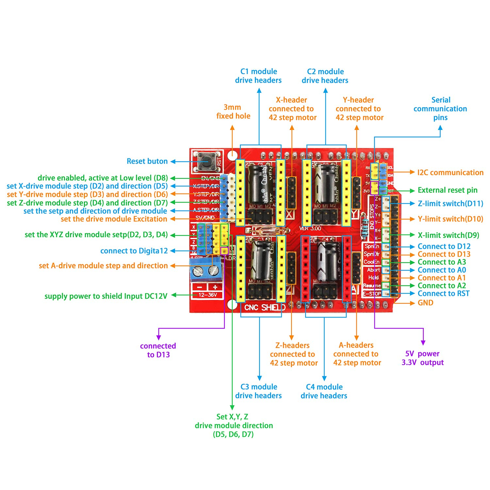

[](https://crates.io/crates/printhor-hwi_nucleo_64_arduino_cnc_hat)
[](https://opensource.org/licenses/MIT)


<h3>Printhor: The highly reliable but not necessarily functional 3D printer and robotics firmware</h3>

<h5><p align="center"><i>If you are using this product or like the project, please <a href="https://github.com/cbruiz/printhor/stargazers">★</a> this repository to show your support! 🤩</i></p></h5>

# Overview

Two base boards are supported in this category.
Either of these general-purpose development boards is meant to be used with the Arduino CNC Shield v3 (hat):


**Important**: Upgrade the Nucleo ST-LINK/V2 firmware to at least version V2J43M28 (build Jun 16 2023 16:43:19).

These development boards have a built-in ST-LINK (SWD) probe, so probe-rs can flash and run the firmware directly over USB:

### nucleo-f410rb
https://os.mbed.com/platforms/ST-Nucleo-F410RB/

Please note that this board is very limited in terms of flash and memory (32kB SRAM, 128kB flash): the firmware only fits
when it is optimized for size, with the `release-opt` profile (about 126kB with `DEFMT_LOG=info`).

Optionally, the stack overflow protection of flip-link can be enabled in .cargo/config.toml (it is disabled by default).
It requires the flip-link tool:
```shell
cargo install flip-link
```

```shell
DEFMT_LOG=info RUST_BACKTRACE=0 RUSTFLAGS='--cfg board="nucleo64-f410rb"' cargo run --profile release-opt --no-default-features --features nucleo_64_arduino_cnc_hat,nucleo64-f410rb --target thumbv7em-none-eabihf --bin printhor
```

### nucleo-l476rg
https://os.mbed.com/platforms/ST-Nucleo-L476RG/

This one is a bit slower, but it has much more RAM and flash (128kB SRAM, 1MB flash): enough even for a firmware that is not optimized for size and has many features.

```shell
DEFMT_LOG=info RUST_BACKTRACE=0 RUSTFLAGS='--cfg board="nucleo64-l476rg"' cargo run --release --no-default-features --features nucleo_64_arduino_cnc_hat,nucleo64-l476rg --target thumbv7em-none-eabihf --bin printhor
```

